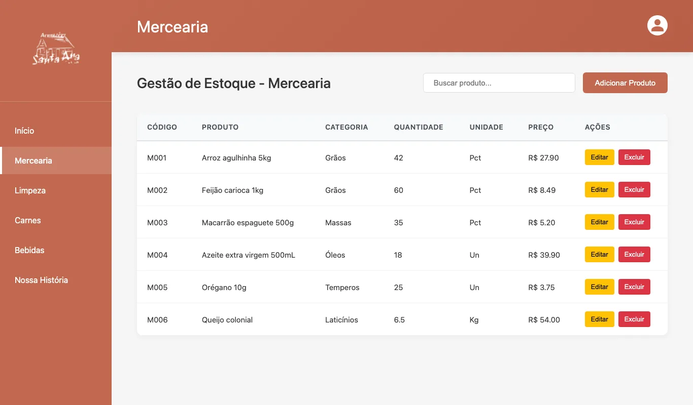
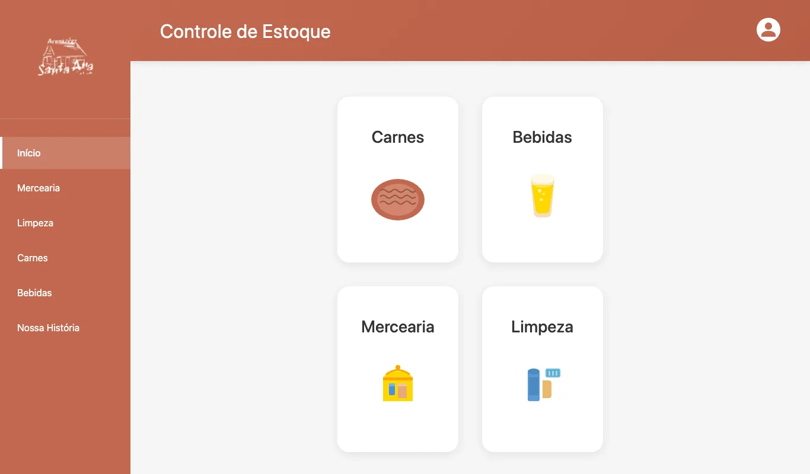
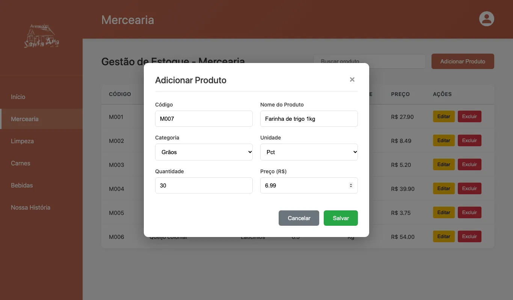
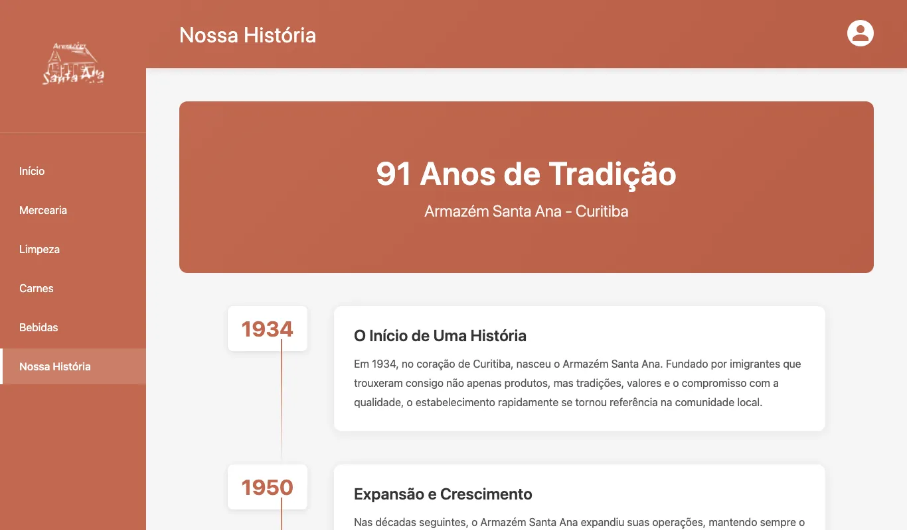
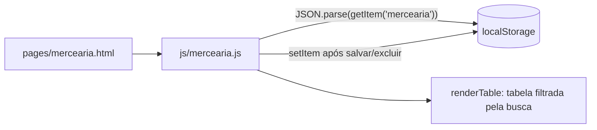

# Santa Ana Stock Manager

Controle de estoque em HTML, CSS e JavaScript puro para o Armazém Santa Ana, armazém tradicional de Curitiba fundado em 1934. Trabalho de faculdade da disciplina de introdução ao desenvolvimento web: um CRUD por categoria de produto, sem backend, com os dados salvos no `localStorage` do navegador.



## Funcionalidades

- Tela inicial com um card por categoria (Carnes, Bebidas, Mercearia, Limpeza).
- Uma página de estoque por categoria, cada uma com:
  - tabela com código, produto, tipo/categoria, quantidade, unidade e preço;
  - busca instantânea por código, nome ou tipo;
  - cadastro e edição no mesmo modal, exclusão com confirmação.
- Página "Nossa História" com a linha do tempo do armazém desde 1934.
- Menu lateral fixo em todas as páginas.

| Início | Cadastro de produto | Nossa História |
| --- | --- | --- |
|  |  |  |

Os produtos das imagens são fictícios.

## Como funciona

Cada página de categoria carrega o seu script (`js/<categoria>.js`). Os quatro scripts são iguais, mudando só a chave do `localStorage` e o ícone da lista vazia:



| Chave no `localStorage` | Tipos disponíveis no formulário | Unidades |
| --- | --- | --- |
| `mercearia` | Grãos, Massas, Conservas, Temperos, Óleos, Laticínios | Kg, g, L, mL, Un, Pct |
| `limpeza` | Detergentes, Desinfetantes, Sabões, Acessórios, Multiuso | L, mL, Kg, g, Un, Pct |
| `carnes` | Bovina, Suína, Frango, Peixe, Outros | Kg, g, Un |
| `bebidas` | Refrigerantes, Cervejas, Sucos, Águas, Vinhos, Destilados | L, mL, Un, Caixa, Fardo |

Cada produto é salvo assim (o `id` é o `Date.now()` do cadastro):

```json
{ "id": "1700000000000", "code": "M001", "name": "Arroz agulhinha 5kg", "category": "Grãos", "unit": "Pct", "quantity": "42", "price": "27.90" }
```

Os dados ficam só no navegador em que foram cadastrados. Para zerar o estoque, limpe os dados do site nas ferramentas do navegador.

## Stack

HTML5, CSS3 e JavaScript (ES6), sem dependências nem build.

## Como rodar

Abra o `index.html` no navegador. Se preferir servir por HTTP:

```bash
python3 -m http.server 8000
# http://localhost:8000
```

## Estrutura

```
├── index.html          # início com os cards de categoria
├── pages/              # mercearia, limpeza, carnes, bebidas, historia
├── js/                 # um script de CRUD por categoria
├── css/                # global (layout e menu), home, crud (tabela e modal), historia
├── assets/             # logo e favicon
└── docs/media/         # imagens deste README
```

## Limitações conhecidas

- O código do produto não é validado como único: dá para cadastrar dois `M001` na mesma categoria.
- A tabela é montada com `innerHTML` sem escapar o texto digitado, então um nome com HTML (`<b>x</b>`) é renderizado como HTML.
- A busca sem resultado mostra a mesma mensagem da lista vazia ("Clique em Adicionar Produto para começar").
- Os quatro scripts de `js/` são cópias; uma correção precisa ser feita nos quatro.
- "91 anos" está escrito fixo em `pages/historia.html`.

## Paleta

Terracota `#C1694F` e `#B85E47`, fundo `#f5f5f5`, texto `#333333`.
